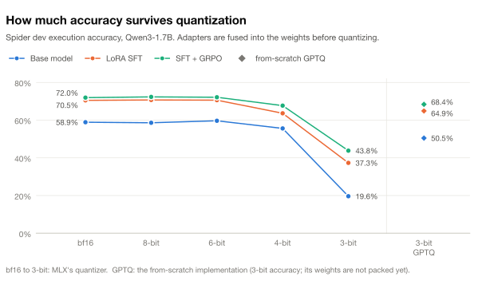
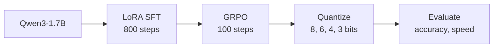
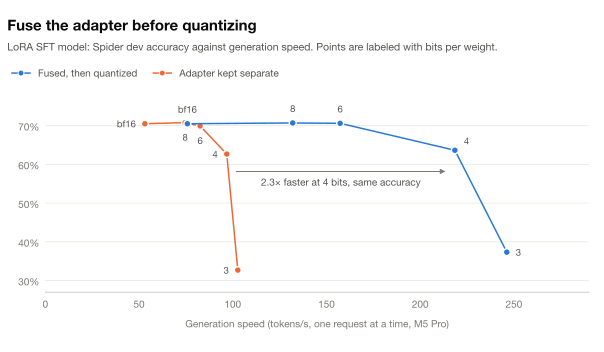

<div align="center">

# shrinkwrap-sql

**Fine-tune, align and shrink a small LLM for text-to-SQL, entirely on a laptop.**

LoRA, RTN, GPTQ and GRPO implemented from scratch in [MLX](https://github.com/ml-explore/mlx),
trained and measured on an Apple M5 Pro (24 GB) against the [Spider](https://yale-lily.github.io/spider) benchmark.

[](pyproject.toml)
[](https://github.com/ml-explore/mlx-lm)
[](https://huggingface.co/Qwen/Qwen3-1.7B)
[](LICENSE)

| **58.9% → 72.0%** | **⅔** | **2.3× faster** | **0.97 GB** |
|:---:|:---:|:---:|:---:|
| Spider dev accuracy,<br>base model to SFT + GRPO | of the fine-tune's gain<br>kept at 4 bits | generation when the adapter<br>is fused before quantizing | best on-device model:<br>67.7% at 218 tokens/s |

</div>

**Research questions:** how much of a fine-tune's gain survives quantization, and how should LoRA
and quantization be combined for on-device deployment? And are RL (GRPO) gains more or less
fragile under quantization than SFT gains?

**Task:** [Spider](https://yale-lily.github.io/spider) (Yu et al., 2018), scored by execution
accuracy: the predicted query runs against the real SQLite database and its result is compared
with the gold query's result.

## Key results

<picture>
  <source media="(prefers-color-scheme: dark)" srcset="docs/figures/accuracy_by_bits-dark.svg">
  
</picture>

Full Spider dev set (1,034 questions), one training run per model. Brackets are paired 95% CIs.

- **Fine-tuning works.** LoRA SFT takes Qwen3-1.7B from 58.9% to 70.5% (+11.6 points [+8.6, +14.6]);
  GRPO on top of it reaches 72.0%.
- **Most of the gain survives quantization.** It is intact at 8 and 6 bits, and about two-thirds of it
  survives 4 bits (+8.0 [+5.0, +11.0]).
- **Fuse first, then quantize.** That ties or beats running the adapter on a quantized model and
  generates 1.8–2.4× faster (at 4 bits, 218 against 97 tok/s).
- **RL gains held up better than SFT gains.** GRPO's edge over SFT is too small to call at full
  precision (+1.5 [−0.2, +3.1]) but larger at 4 bits (+4.1 [+2.3, +5.9]).
- **3-bit GPTQ matches MLX's 4-bit accuracy** on the fine-tune (64.9% against 63.6%, no significant
  difference) and beats 3-bit RTN by 31 points. These GPTQ models are not packed yet, so they show
  3-bit accuracy without the size savings.
- **Best deployable model:** GRPO, fused, MLX 4-bit: 67.7% in 0.97 GB at 218 tok/s, against 76 tok/s
  and 3.44 GB at full precision.

For scale, the best published result found on this split is 87.6% (a 7B model with voting over 8
samples), and CodeS-1B reaches 77.9%; both use more data and richer prompts. See
[Results](#results) and [How this compares](#how-this-compares-with-published-results).

## How it works



The base model and the model after each training stage are each quantized and evaluated. Each
adapter is fused into the weights before the next stage, and the SFT and GRPO adapters are also
evaluated unfused, running on top of the quantized model, to compare the two ways of combining
LoRA and quantization.

- **Base model: Qwen3-1.7B.** A plain dense transformer, so LoRA and quantization results are
  easy to interpret. Qwen3.5-2B mixes linear and full attention, which would confound the
  quantization study. Thinking is disabled (`enable_thinking=False`); outputs stay short.
- **Same prompt for training and eval.** `tests/test_prompts.py` checks that the rendered
  inference prompt is an exact token prefix of the rendered training example, which catches
  chat-template drift.
- **Untrusted SQL is sandboxed:** read-only connection, an authorizer that only allows reads,
  a timeout and a row cap.
- **Report uncertainty:** each summary has a Wilson 95% CI; `shrinkwrap.compare` gives a paired
  bootstrap CI on differences. On 200 examples the CI is about ±6–7 points, so use the full dev
  set (1,034) before claiming small differences.

> [!NOTE]
> **Known limitation:** this is plain execution accuracy, not the official
> [test-suite evaluation](https://github.com/taoyds/test-suite-sql-eval). Two queries that both
> return no rows always "match", so numbers run slightly optimistic versus the official metric.

## Results

Everything is execution accuracy on the full Spider dev set (1,034 questions), and every difference is
a paired bootstrap 95% CI from `shrinkwrap.compare`. Gold SQL against itself scores 1.000
[0.996, 1.000], a harness sanity check. Each model is one training run with seed 0.
`scripts/overnight.sh` reruns everything in about 2 h 40 min, and `scripts/speed_bench.py` the speed
columns.

- **Base:** Qwen3-1.7B; 11.4% of its queries fail to execute.
- **SFT:** from-scratch LoRA and loss; rank 16 on every layer, 800 steps.
- **GRPO:** from-scratch GRPO math on top of the fused SFT model; a second rank-16 LoRA, 100 steps of
  4 training questions × 8 samples, learning rate 1e-5, KL weight 0.04, 42 minutes.
- **Fused** rows merge the adapter into the weights, then quantize. **+ adapter** rows run the adapter
  on top of the quantized model (for GRPO, on top of the quantized SFT model). The from-scratch RTN and
  GPTQ quantize the transformer blocks only; MLX's quantizer (`mlx_lm convert`) also quantizes the embedding.

| Format | Weights | Generation | Peak memory | Base | SFT | GRPO |
|---|---|---|---|---|---|---|
| bf16, fused | 3.44 GB | 76 tok/s | 3.82 GB | 0.589 | 0.705 | — |
| bf16 + adapter | 3.44 GB + 70 MB | 53 tok/s | 4.44 GB | | 0.705 | 0.720 |
| MLX 8-bit, fused | 1.83 GB | 132 tok/s | 2.39 GB | 0.586 | 0.707 | 0.723 |
| MLX 8-bit + adapter | 1.83 GB + 70 MB | 75 tok/s | 3.35 GB | | 0.708 | 0.725 |
| MLX 6-bit, fused | 1.40 GB | 157 tok/s | 2.01 GB | 0.597 | 0.706 | 0.722 |
| MLX 6-bit + adapter | 1.40 GB + 70 MB | 83 tok/s | 2.79 GB | | 0.699 | 0.729 |
| **MLX 4-bit, fused** | **0.97 GB** | **218 tok/s** | **1.60 GB** | 0.556 | 0.636 | **0.677** |
| MLX 4-bit + adapter | 0.97 GB + 70 MB | 97 tok/s | 2.44 GB | | 0.627 | 0.674 |
| MLX 3-bit, fused | 0.75 GB | 246 tok/s | 1.36 GB | 0.196 | 0.373 | 0.438 |
| MLX 3-bit + adapter | 0.75 GB + 70 MB | 103 tok/s | 2.14 GB | | 0.327 | 0.424 |
| From-scratch RTN 4-bit | 1.42 GB | 164 tok/s | 2.05 GB | 0.578 | 0.655 | — |
| From-scratch RTN 3-bit | 1.24 GB | 177 tok/s | 1.90 GB | 0.147 | 0.335 | — |
| From-scratch GPTQ 3-bit (fake) | 3.44 GB | 76 tok/s | 3.82 GB | 0.505 | 0.649 | 0.684 |

The base model has no adapter, so its adapter rows are blank; — means not run (fusing is lossless, so
the bf16 GRPO result is its adapter row). Generation is single-stream speed on the M5 Pro: batch 1, a
384-token prompt, 128 generated tokens, median of 5 runs. Peak memory is at that size; batched
evaluation peaks at 8–11 GB. Don't compare the evaluations' `batched_generation_tps` across models: a
broken model that rambles to the token limit keeps the batch full and looks faster.

### 1. How much of the fine-tune's gain survives quantization

SFT adds **+11.6 points** at bf16 (+8.6 to +14.6): 190 questions only the fine-tune gets right, 70
only the base. Fused and quantized with MLX, the gain is +12.1 at 8 bits and +10.9 at 6, so it
survives intact. At 4 bits about two-thirds of it survives: +8.0 (+5.0 to +11.0) with MLX and +7.6
(+4.7 to +10.5) with the from-scratch RTN. Both quantizers cost the SFT model more than the base: MLX
4-bit costs it 6.9 points (4.6 to 9.1) against 3.3 (0.7 to 5.9) for the base, and the from-scratch
4-bit RTN 5.0 (3.1 to 7.1) against 1.1 (−1.6 to 3.8). What fine-tuning adds looks more fragile than
what the model already knew. At 3 bits the gain grows in points (+17.7 with MLX, +14.4 with the
from-scratch GPTQ), but only because the base model collapses further.

### 2. How to combine LoRA and quantization: fuse first, then quantize

<picture>
  <source media="(prefers-color-scheme: dark)" srcset="docs/figures/fuse_vs_adapter-dark.svg">
  
</picture>

Fusing is lossless (0.705 before and after; 5 answers change each way). Fused-then-quantized ties
the adapter on a quantized base at 8, 6 and 4 bits (4-bit: +1.0, −0.8 to +2.7) and beats it at 3
bits (+4.6, +2.2 to +7.2). It also generates 1.8–2.4× faster: at 4 bits, 218 against 97 tok/s, with
0.8 GB less memory. The separate adapter adds two small matrix multiplies to each of the 196 adapted
layers for every token, and at batch 1 those extra operations dominate: 4-bit with an adapter is only
1.3× faster than bf16 fused. Keep adapters separate only when one base model has to serve many of
them.

### 3. From-scratch 3-bit GPTQ matches MLX's 4-bit accuracy

On the fused SFT model it scores 0.649, tied with MLX 4-bit's 0.636 (+1.3, −1.2 to +3.7) and 31.4
points above the from-scratch 3-bit RTN (+28.3 to +34.5). On the base model it is 35.8 points above
RTN (+32.7 to +38.9). The exact zero point matters even with GPTQ: the naive zero scores 0.460
against 0.530 on the 200-question subset.

> [!IMPORTANT]
> These GPTQ models are fake-quantized (bf16 weights rounded to the 3-bit grid), so they have 3-bit
> accuracy at bf16 size and speed. Packed the way the RTN models are (a stretch goal in the guide),
> they would run like the "From-scratch RTN 3-bit" row: 1.24 GB at 177 tok/s.

From-scratch RTN against MLX's: tied at 4 bits (+2.2 on the base, −0.4 to +4.8; +1.8 on SFT, −0.2 to
+3.9), worse at 3 bits (−4.9 on the base, −7.6 to −2.2; −3.9 on SFT, −6.6 to −1.1). It is 25% slower
and 0.45 GB larger at 4 bits because the embedding stays bf16: Qwen3-1.7B shares it with the output
layer, so all 0.62 GB of it is read for every generated token.

### 4. Are RL gains more or less fragile under quantization than SFT gains? Less, here

GRPO adds +1.5 points over SFT at bf16 (−0.2 to +3.1), too small to call on its own, and cuts
queries that fail to execute from 9.2% to 7.3%. Under quantization its gain holds or grows: +1.6 at
8 bits, +1.5 at 6, **+4.1 at 4** (+2.3 to +5.9), +6.5 at MLX 3-bit (+4.3 to +8.8) and +3.5 with the
from-scratch 3-bit GPTQ (+1.2 to +5.9). Put the other way, MLX 4-bit costs the GRPO model 4.3 points
(2.2 to 6.2) against 6.9 for the SFT model, and the from-scratch 3-bit GPTQ costs it 3.6 (1.6 to 5.5)
against 5.6 (3.5 to 7.7). A possible reason, not tested here: GRPO sharpens the output distribution.
Its sampled accuracy on training questions rose from about 51% in the first 10 steps to about 70% by
the end, while greedy dev accuracy rose 1.5 points, and wider margins between the top token and the
next leave less room for quantization noise to flip a choice.

> [!NOTE]
> **Limitations.** One seed per model, so run-to-run variance isn't measured; plain execution
> accuracy (see above); and GRPO ran only 100 steps. By the end, about 2.4 of each step's 4 questions
> taught nothing because all 8 samples got the same reward, so a longer run needs harder questions.

## How this compares with published results

Published execution accuracy on the same split (Spider dev, 1,034 questions):

| System | Size | Spider dev EX | Beyond a plain schema prompt and one greedy answer |
|---|---|---|---|
| **This project: Qwen3-1.7B base** | 1.7B | **0.589** | — |
| **This project: + LoRA SFT** | 1.7B | **0.705** | — |
| **This project: + GRPO** | 1.7B | **0.720** | — |
| **This project: + GRPO, MLX 4-bit, 0.97 GB** | 1.7B | **0.677** | — |
| [CodeS-1B](https://arxiv.org/abs/2402.16347), fine-tuned | 1B | 0.779 | 21.5 GB of SQL-focused pretraining, schema filtering, database values in the prompt, 4-beam search keeping the first query that runs |
| [SQL-R1](https://arxiv.org/abs/2504.08600)-3B, RL | 3B | 0.781 | code base model (Qwen2.5-Coder), majority vote over 8 samples |
| CodeS-3B, fine-tuned | 3B | 0.834 | as CodeS-1B |
| GPT-4, few-shot | — | 0.768 | few-shot examples |
| [DAIL-SQL](https://arxiv.org/abs/2308.15363) + GPT-4 + self-consistency | — | 0.836 | retrieved examples, voting; 86.6% on the test set, first on the official leaderboard when it closed in February 2024 |
| CodeS-7B, fine-tuned | 7B | 0.854 | as CodeS-1B |
| SQL-R1-7B, RL | 7B | 0.876 | as SQL-R1-3B; the best dev result found |

Numbers are from the CodeS paper's Table 5 (including the GPT-4 and DAIL-SQL rows) and SQL-R1's Table 1.
On the test set the best systems reach about 88–89% (e.g. [OmniSQL](https://github.com/RUCKBReasoning/OmniSQL)-7B,
87.9% with greedy decoding). Papers that report Spider dev with test-suite accuracy (OmniSQL, the TS
columns in CodeS) aren't comparable with the numbers here; it runs 5–9 points lower (CodeS-1B: 0.779
EX, 0.722 TS).

The GRPO model is about 6 points behind CodeS-1B and SQL-R1-3B, and 16 behind the best result
overall. The setups differ in ways that mostly favor the published systems:

- **No database values in the prompt.** CodeS and OmniSQL add representative values for each column
  and values that match the question, which helps with literals (`'France'` or `'FR'`?). Here the
  prompt has only the `CREATE TABLE` statements (`evaluate.py --rows-per-table` adds sample rows).
- **One greedy answer.** Most of the published systems choose among several candidates. 7.3% of the GRPO
  model's queries fail to execute, and keeping the first candidate that runs could recover some of them.
- **Less SQL data and a general-purpose model.** Training here uses Spider's 6,452 examples on
  Qwen3-1.7B; CodeS and SQL-R1 start from code models and add far more SQL data (CodeS's 21.5 GB of
  pretraining; OmniSQL's 2.5M synthetic examples).

None of the papers above study what their gains keep under quantization, which is this project's focus.

## Reproduce it

```bash
make setup        # venv + dependencies (Python 3.13)
make data         # Spider from the official source, checksum-verified (~200 MB)
make test         # unit tests, including a chat-template consistency check
make gold-check   # harness sanity check: gold SQL must score 100% on dev
make baseline     # base model on a seeded 200-example dev subset
make figures      # redraw the charts above from results/
```

Every evaluation writes `results/<name>.jsonl` (one row per example, with the model output,
extracted SQL and errors, for error analysis) and `results/<name>.json` (summary with a 95% CI,
throughput and peak memory). `LIMIT=1034` evaluates the full dev set. With a trained SFT adapter in
`adapters/mine_r16`, `scripts/overnight.sh` reruns every experiment behind the results, unattended
and resumable.

## Implementing the techniques yourself

LoRA, the SFT loss, RTN quantization, GPTQ and GRPO are exercises: stubs with tests, plus scripts
that run them on the real model. **[IMPLEMENTATION_GUIDE.md](IMPLEMENTATION_GUIDE.md)** says what
to implement, how, and how to run and test each piece.

<details>
<summary><b>Repository layout</b></summary>

```
src/shrinkwrap/spider.py     Spider loading, seeded subsets, schema serialization
src/shrinkwrap/prompts.py    one prompt format shared by training and eval; SQL extraction
src/shrinkwrap/sqlexec.py    sandboxed read-only execution; result matching
src/shrinkwrap/evaluate.py   batched MLX generation -> execution accuracy
src/shrinkwrap/compare.py    paired bootstrap comparison of two runs
src/shrinkwrap/reward.py     verifiable reward for GRPO (same checks as eval)
src/shrinkwrap/modules.py    finding and swapping a model's linear layers
src/shrinkwrap/calibrate.py  model-level fake and real quantization, sequential GPTQ calibration

src/shrinkwrap/lora.py       exercise 1: LoRA layer
src/shrinkwrap/losses.py     exercise 2: masked SFT loss
src/shrinkwrap/quant.py      exercise 3: group-wise RTN quantization, fake and real
src/shrinkwrap/gptq.py       exercise 4: GPTQ
src/shrinkwrap/grpo.py       exercise 5: GRPO
src/shrinkwrap/margins.py    exercise 6: token margins and flips under quantization

scripts/train_sft.py         LoRA SFT with your LoRA + loss (or mlx_lm's, for comparison)
scripts/quantize_model.py    quantize with your RTN (fake or real) or GPTQ, save for evaluation
scripts/train_grpo.py        GRPO with your LoRA + GRPO math
scripts/quant_sweep.py       real MLX quantization sweep across pipelines and bit widths
scripts/margin_analysis.py   which tokens quantization flips, by margin (exercise 6)
scripts/speed_bench.py       single-stream generation speed of each model format
scripts/overnight.sh         every experiment behind the results, unattended and resumable
scripts/make_figures.py      the README's charts, drawn from results/
tests/exercises/             exercise tests (skipped until implemented)
```

</details>

## License and citation

The code is MIT-licensed ([LICENSE](LICENSE)). Spider is CC BY-SA 4.0. Cite Yu et al., "Spider: A
Large-Scale Human-Labeled Dataset for Complex and Cross-Domain Semantic Parsing and Text-to-SQL
Task", EMNLP 2018.
