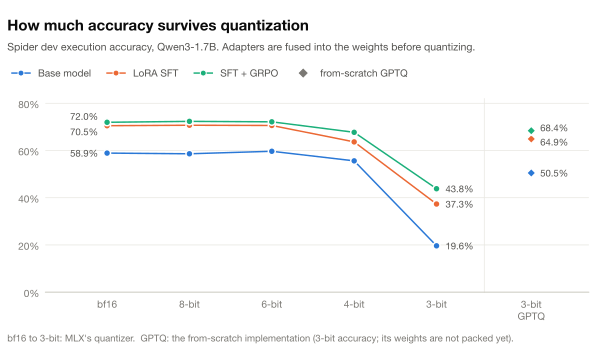
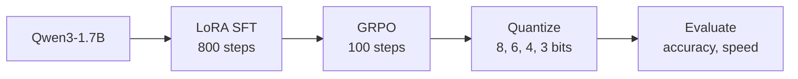
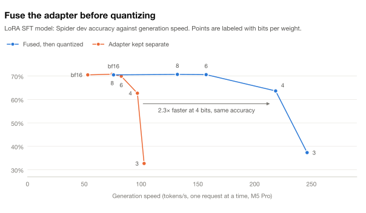

<div align="center">

# shrinkwrap-sql

**Fine-tune, align and shrink a small LLM for text-to-SQL, entirely on a laptop.**

LoRA, RTN, GPTQ and GRPO implemented from scratch in [MLX](https://github.com/ml-explore/mlx),
trained and measured on an Apple M5 Pro (24 GB) against the [Spider](https://yale-lily.github.io/spider) benchmark.

[](pyproject.toml)
[](https://github.com/ml-explore/mlx-lm)
[](https://huggingface.co/Qwen/Qwen3-1.7B)
[](LICENSE)

| **58.9% → 72.0%** | **⅔** | **2.3× faster** | **0.97 GB** |
|:---:|:---:|:---:|:---:|
| Spider dev accuracy,<br>base model to SFT + GRPO | of the fine-tune's gain<br>kept at 4 bits | generation when the adapter<br>is fused before quantizing | best on-device model:<br>67.7% at 218 tokens/s |

</div>

**Research questions:** how much of a fine-tune's gain survives quantization, and how should LoRA
and quantization be combined for on-device deployment? And are RL (GRPO) gains more or less
fragile under quantization than SFT gains?

**Task:** [Spider](https://yale-lily.github.io/spider) (Yu et al., 2018), scored by execution
accuracy: the predicted query runs against the real SQLite database and its result is compared
with the gold query's result.

## Key results

<picture>
  <source media="(prefers-color-scheme: dark)" srcset="docs/figures/accuracy_by_bits-dark.svg">
  
</picture>

Full Spider dev set (1,034 questions). One training run per model, plus three more GRPO seeds and
two controls behind the two GRPO results. Brackets are paired 95% CIs.

- **Fine-tuning works.** LoRA SFT takes Qwen3-1.7B from 58.9% to 70.5% (+11.6 points [+8.6, +14.6]);
  GRPO on top of it reaches 72.0%, or 72.6% once its adapter is fused into the weights.
- **Most of the gain survives quantization.** It is intact at 8 and 6 bits, and about two-thirds of it
  survives 4 bits (+8.0 [+5.0, +11.0]).
- **Fuse first, then quantize.** That ties or beats running the adapter on a quantized model and
  generates 1.8–2.4× faster (at 4 bits, 218 against 97 tok/s).
- **GRPO's gain is real, and nothing shows it surviving quantization better than SFT's.** Across four
  seeds GRPO adds +1.3 to +2.4 points at full precision, and its 4-bit models stay ahead of a random
  change of the same size (+2.2 [+0.9, +3.6]). But it loses as much on the way down: it keeps +0.1
  points more through 4 bits than the random change does [−1.6, +1.8]. An earlier claim of more
  robustness at 3 bits came from one run, and one of the four seeds ends up below SFT there.
- **GRPO widens token margins on every seed, and that does not buy robustness.** The median margin
  rises from 6.1 to between 7.9 and 8.6, but quantization also moves GRPO's scores more, so 4 bits
  changes about as many answers: 44% to 52% across seeds, against 49% for SFT.
- **3-bit GPTQ matches MLX's 4-bit accuracy** on the fine-tune (64.9% against 63.6%, no significant
  difference) and beats 3-bit RTN by 31 points. These GPTQ models are not packed yet, so they show
  3-bit accuracy without the size savings.
- **Best deployable model:** GRPO, fused, MLX 4-bit: 67.7% in 0.97 GB at 218 tok/s, against 76 tok/s
  and 3.44 GB at full precision. That is seed 0; the other three seeds score 63.4% to 67.4% at 4
  bits.

For scale, the best published result found on this split is 87.6% (a 7B model with voting over 8
samples), and CodeS-1B reaches 77.9%; both use more data and richer prompts. See
[Results](#results) and [How this compares](#how-this-compares-with-published-results).

## How it works



The base model and the model after each training stage are each quantized and evaluated. Each
adapter is fused into the weights before the next stage, and the SFT and GRPO adapters are also
evaluated unfused, running on top of the quantized model, to compare the two ways of combining
LoRA and quantization.

- **Base model: Qwen3-1.7B.** A plain dense transformer, so LoRA and quantization results are
  easy to interpret. Qwen3.5-2B mixes linear and full attention, which would confound the
  quantization study. Thinking is disabled (`enable_thinking=False`); outputs stay short.
- **Same prompt for training and eval.** `tests/test_prompts.py` checks that the rendered
  inference prompt is an exact token prefix of the rendered training example, which catches
  chat-template drift.
- **Untrusted SQL is sandboxed:** read-only connection, an authorizer that only allows reads,
  a timeout and a row cap.
- **Report uncertainty:** each summary has a Wilson 95% CI; `shrinkwrap.compare` gives a paired
  bootstrap CI on differences. On 200 examples the CI is about ±6–7 points, so use the full dev
  set (1,034) before claiming small differences.

> [!NOTE]
> **Known limitation:** this is plain execution accuracy, not the official
> [test-suite evaluation](https://github.com/taoyds/test-suite-sql-eval). Two queries that both
> return no rows always "match", so numbers run slightly optimistic versus the official metric.

## Results

Everything is execution accuracy on the full Spider dev set (1,034 questions), and every difference is
a paired bootstrap 95% CI from `shrinkwrap.compare`. Gold SQL against itself scores 1.000
[0.996, 1.000], a harness sanity check. Each model in the table is one training run with seed 0;
findings 4 and 5 add three more GRPO seeds and two controls.
`scripts/overnight.sh` reruns everything in about 2 h 40 min, and `scripts/speed_bench.py` the speed
columns.

- **Base:** Qwen3-1.7B; 11.4% of its queries fail to execute.
- **SFT:** from-scratch LoRA and loss; rank 16 on every layer, 800 steps.
- **GRPO:** from-scratch GRPO math on top of the fused SFT model; a second rank-16 LoRA, 100 steps of
  4 training questions × 8 samples, learning rate 1e-5, KL weight 0.04, 42 minutes.
- **Fused** rows merge the adapter into the weights, then quantize. **+ adapter** rows run the adapter
  on top of the quantized model (for GRPO, on top of the quantized SFT model). The from-scratch RTN and
  GPTQ quantize the transformer blocks only; MLX's quantizer (`mlx_lm convert`) also quantizes the embedding.

| Format | Weights | Generation | Peak memory | Base | SFT | GRPO |
|---|---|---|---|---|---|---|
| bf16, fused | 3.44 GB | 76 tok/s | 3.82 GB | 0.589 | 0.705 | 0.726 |
| bf16 + adapter | 3.44 GB + 70 MB | 53 tok/s | 4.44 GB | | 0.705 | 0.720 |
| MLX 8-bit, fused | 1.83 GB | 132 tok/s | 2.39 GB | 0.586 | 0.707 | 0.723 |
| MLX 8-bit + adapter | 1.83 GB + 70 MB | 75 tok/s | 3.35 GB | | 0.708 | 0.725 |
| MLX 6-bit, fused | 1.40 GB | 157 tok/s | 2.01 GB | 0.597 | 0.706 | 0.722 |
| MLX 6-bit + adapter | 1.40 GB + 70 MB | 83 tok/s | 2.79 GB | | 0.699 | 0.729 |
| **MLX 4-bit, fused** | **0.97 GB** | **218 tok/s** | **1.60 GB** | 0.556 | 0.636 | **0.677** |
| MLX 4-bit + adapter | 0.97 GB + 70 MB | 97 tok/s | 2.44 GB | | 0.627 | 0.674 |
| MLX 3-bit, fused | 0.75 GB | 246 tok/s | 1.36 GB | 0.196 | 0.373 | 0.438 |
| MLX 3-bit + adapter | 0.75 GB + 70 MB | 103 tok/s | 2.14 GB | | 0.327 | 0.424 |
| From-scratch RTN 4-bit | 1.42 GB | 164 tok/s | 2.05 GB | 0.578 | 0.655 | — |
| From-scratch RTN 3-bit | 1.24 GB | 177 tok/s | 1.90 GB | 0.147 | 0.335 | — |
| From-scratch GPTQ 3-bit (fake) | 3.44 GB | 76 tok/s | 3.82 GB | 0.505 | 0.649 | 0.684 |

The base model has no adapter, so its adapter rows are blank; — means not run. The GRPO model scores
0.720 with its adapter kept separate and 0.726 once fused: fusing changes 66 answers, 13 for the
better and 6 for the worse, which is within noise (−0.1 to +1.5 points). Comparisons with quantized
GRPO models below start from the fused model, because that is the one that gets quantized.

Generation is single-stream speed on the M5 Pro: batch 1, a
384-token prompt, 128 generated tokens, median of 5 runs. Peak memory is at that size; batched
evaluation peaks at 8–11 GB. Don't compare the evaluations' `batched_generation_tps` across models: a
broken model that rambles to the token limit keeps the batch full and looks faster.

### 1. How much of the fine-tune's gain survives quantization

SFT adds **+11.6 points** at bf16 (+8.6 to +14.6): 190 questions only the fine-tune gets right, 70
only the base. Fused and quantized with MLX, the gain is +12.1 at 8 bits and +10.9 at 6, so it
survives intact. At 4 bits about two-thirds of it survives: +8.0 (+5.0 to +11.0) with MLX and +7.6
(+4.7 to +10.5) with the from-scratch RTN. Both quantizers cost the SFT model more than the base: MLX
4-bit costs it 6.9 points (4.6 to 9.1) against 3.3 (0.7 to 5.9) for the base, and the from-scratch
4-bit RTN 5.0 (3.1 to 7.1) against 1.1 (−1.6 to 3.8). What fine-tuning adds looks more fragile than
what the model already knew. At 3 bits the gain grows in points (+17.7 with MLX, +14.4 with the
from-scratch GPTQ), but only because the base model collapses further.

### 2. How to combine LoRA and quantization: fuse first, then quantize

<picture>
  <source media="(prefers-color-scheme: dark)" srcset="docs/figures/fuse_vs_adapter-dark.svg">
  
</picture>

Fusing is lossless (0.705 before and after; 5 answers change each way). Fused-then-quantized ties
the adapter on a quantized base at 8, 6 and 4 bits (4-bit: +1.0, −0.8 to +2.7) and beats it at 3
bits (+4.6, +2.2 to +7.2). It also generates 1.8–2.4× faster: at 4 bits, 218 against 97 tok/s, with
0.8 GB less memory. The separate adapter adds two small matrix multiplies to each of the 196 adapted
layers for every token, and at batch 1 those extra operations dominate: 4-bit with an adapter is only
1.3× faster than bf16 fused. Keep adapters separate only when one base model has to serve many of
them.

### 3. From-scratch 3-bit GPTQ matches MLX's 4-bit accuracy

On the fused SFT model it scores 0.649, tied with MLX 4-bit's 0.636 (+1.3, −1.2 to +3.7) and 31.4
points above the from-scratch 3-bit RTN (+28.3 to +34.5). On the base model it is 35.8 points above
RTN (+32.7 to +38.9). The exact zero point matters even with GPTQ: the naive zero scores 0.460
against 0.530 on the 200-question subset.

> [!IMPORTANT]
> These GPTQ models are fake-quantized (bf16 weights rounded to the 3-bit grid), so they have 3-bit
> accuracy at bf16 size and speed. Packed the way the RTN models are (a stretch goal in the guide),
> they would run like the "From-scratch RTN 3-bit" row: 1.24 GB at 177 tok/s.

From-scratch RTN against MLX's: tied at 4 bits (+2.2 on the base, −0.4 to +4.8; +1.8 on SFT, −0.2 to
+3.9), worse at 3 bits (−4.9 on the base, −7.6 to −2.2; −3.9 on SFT, −6.6 to −1.1). It is 25% slower
and 0.45 GB larger at 4 bits because the embedding stays bf16: Qwen3-1.7B shares it with the output
layer, so all 0.62 GB of it is read for every generated token.

### 4. Are RL gains more or less fragile under quantization than SFT gains? No evidence of a difference

An earlier version of this section, based on one GRPO run, said the RL gain was more robust at 3
bits. Three more seeds and two controls were then run against a rule fixed beforehand (section 7 of
the [guide](IMPLEMENTATION_GUIDE.md)), and the claim did not hold.

**GRPO does make the model better.** Across four seeds it adds +1.3 to +2.4 points over SFT at full
precision, comparing fused models, and seed 0 cuts queries that fail to execute from 9.2% to 6.9%.

**Whether it loses less when quantized is a separate question.** "Kept" below is what a model loses
going from full precision to the quantized format, set against what the SFT model loses, question by
question. Positive means it lost less.

| Model | bf16 | MLX 4-bit | MLX 3-bit | Gain over SFT at bf16 | Kept through 4-bit | Kept through 3-bit |
|---|---|---|---|---|---|---|
| SFT | 0.705 | 0.636 | 0.373 | | | |
| GRPO, seed 0 | 0.726 | 0.677 | 0.438 | +2.1 (+0.6 to +3.7) | +1.9 (−0.2 to +4.1) | +4.4 (+1.6 to +7.1) |
| GRPO, seed 1 | 0.724 | 0.663 | 0.431 | +1.9 (+0.2 to +3.6) | +0.8 (−1.5 to +3.1) | +3.9 (+0.9 to +6.9) |
| GRPO, seed 2 | 0.729 | 0.674 | 0.457 | +2.4 (+0.7 to +4.2) | +1.4 (−1.0 to +3.7) | +5.9 (+2.9 to +8.9) |
| GRPO, seed 3 | 0.718 | 0.634 | 0.348 | +1.3 (−0.7 to +3.1) | −1.5 (−4.0 to +1.1) | −3.8 (−6.7 to −0.9) |
| Random change, five draws | 0.702 to 0.705 | 0.637 to 0.644 | 0.361 to 0.375 | −0.3 to 0.0 | +0.4 to +0.8 | −1.1 to +0.5 |
| 100 more SFT steps | 0.708 | 0.648 | 0.400 | +0.3 (−1.1 to +1.6) | +0.9 (−1.1 to +2.8) | +2.4 (+0.1 to +4.6) |

The two controls sit on the same SFT model that GRPO does:

- **Random change:** an adapter that changes every layer by exactly as much as GRPO's does, in a
  random direction. It shows what a change of that size does on its own.
- **100 more SFT steps:** GRPO seed 0's exact 400 questions and optimizer settings, with the SFT loss
  in place of RL. It shows what more training on those questions does on its own. The same run at
  the SFT learning rate, 20 times higher, broke the model (0.427 at full precision).

The test compares the average of the four GRPO seeds with the average of the five random changes.
The claim holds only if the CI over questions excludes zero and the p over seeds is below 0.05.

| GRPO seeds minus random changes | Points | 95% CI over questions | p over seeds |
|---|---|---|---|
| **Kept through 4-bit (the claim)** | **+0.1** | −1.6 to +1.8 | 0.48 |
| Kept through 3-bit | +2.9 | +0.9 to +5.0 | 0.071 |
| Accuracy at full precision | +2.1 | +0.8 to +3.5 | 0.008 |
| Accuracy at 4 bits | +2.2 | +0.9 to +3.6 | 0.048 |

- **At 4 bits there is nothing.** GRPO keeps +0.7 points on average and a random change keeps +0.6.
  Every random change keeps a little, which says the SFT model's own 4-bit score sits slightly low
  and any model near it does a little better.
- **At 3 bits it depends on the seed.** Three seeds keep 3.9 to 5.9 points more than SFT. The fourth
  keeps 3.8 less and ends below the SFT model, 0.348 against 0.373. The CI over questions excludes
  zero and the p over seeds does not, so this fails too.
- **The accuracy gain is what survives.** GRPO's models are about 2 points better at full precision
  and about 2 points better at 4 bits. The 4-bit model inherits the gain and does not protect it.
- **Extra SFT accounts for part of even that.** Against 100 more SFT steps on the same questions,
  GRPO is ahead by +1.6 at full precision (+0.0 to +3.2) and +1.4 at 4 bits (−0.1 to +2.9), and keeps
  −0.2 through 4 bits (−2.2 to +1.7).

Seed 0 alone had pointed the other way, with +1.9 kept at 4 bits and +4.4 at 3. It was the best of
the four seeds at 4 bits and the second best at 3. Only seed 0 was run in the other formats, and
there it kept −0.5 at 8 bits (−1.5 to +0.5), −0.6 at 6 (−1.9 to +0.9) and +1.4 with the from-scratch
3-bit GPTQ (−1.5 to +4.0).

### 5. GRPO widens token margins on every seed, and quantization still changes as many answers

Greedy decoding picks the top-scoring token at every step, so quantization changes an answer only
where it reorders the top two. `scripts/margin_analysis.py` measures that directly. The
full-precision model writes its answer to each dev question, then it and its quantized version score
that same answer token by token. At each token the script records the **margin** (how far the top
token's score is ahead of the runner-up's in the full-precision model) and whether the quantized
model would pick a different token there, a **flip**. An answer changes exactly when at least one of
its tokens flips.

| | SFT | GRPO, four seeds | Random change, five draws | 100 more SFT steps |
|---|---|---|---|---|
| Median token margin | 6.1 | 7.9 to 8.6 | 6.1 | 6.9 |
| Tokens with a margin under 1 | 6.8% | 3.8% to 5.1% | 6.8% to 6.9% | 5.8% |
| Spread of the shift in the top-two gap, 4-bit | 0.97 | 1.16 to 1.26 | 0.95 to 0.99 | 0.99 |
| Tokens that flip, 4-bit | 2.31% | 2.05% to 2.54% | 2.23% to 2.35% | 2.30% |
| Answers with a flipped token, 4-bit | 49.2% | 43.9% to 51.9% | 48.5% to 50.5% | 51.0% |
| Net share of flipped answers that go wrong, 4-bit | 14.1% | 10.4% to 15.6% | 11.9% to 13.2% | 11.2% |
| Tokens that flip, 3-bit | 8.17% | 6.87% to 7.71% | 8.00% to 8.08% | 7.55% |
| Answers with a flipped token, 3-bit | 83.8% | 78.5% to 84.1% | 83.2% to 84.1% | 80.7% |
| Net share of flipped answers that go wrong, 3-bit | 39.4% | 34.5% to 43.8% | 39.1% to 40.6% | 37.9% |

The net share is flipped answers that go from right to wrong, minus those that go from wrong to
right.

- **Margins predict flips, and flips account for the accuracy change.** At 4 bits, 45% of the SFT
  model's tokens with a margin under 0.25 flip, against 0.02% of those between 4 and 8. Answers with
  no flipped token keep the same text in the evaluation 95–98% of the time, and at most 6 of them per
  run change correctness.
- **GRPO widens margins, on all four seeds.** The median rises from 6.1 to between 7.9 and 8.6, and
  tokens with a margin under 1 fall from 6.8% to between 3.8% and 5.1%. A random change of the same
  size leaves both where they were.
- **Quantization also moves GRPO's scores more, on all four seeds.** So at the same margin a GRPO
  token flips more often: with a margin between 0.5 and 1, 15% of SFT's tokens flip at 4 bits and
  23% to 26% of GRPO's. Margins alone would predict 1.4% to 1.7% of GRPO's tokens flipping; 2.1% to
  2.5% do, against SFT's 2.3%.
- **At 4 bits the two cancel.** GRPO's seeds change 44% to 52% of their answers, around SFT's 49%.
  A changed answer goes wrong 10% to 16% of the time, around the 12% to 13% that follows a random
  change. Seed 0 is the low end of both ranges, which is what an earlier version of this finding
  reported as GRPO's advantage.
- **At 3 bits fewer GRPO tokens flip on every seed, and that still does not settle the accuracy.**
  Seed 3 changes as many answers as SFT does, and its changed answers go wrong more often (43.8%
  against 39.4%).

So wider margins are a real and repeatable effect of GRPO, and under this quantizer they are not a
route to robustness: the scores they separate are also pushed around more. Why quantization moves a
GRPO model's scores more is not explained here.

### 6. Can an LLM fix the 3-bit model by editing its weights? It found the cause of one failure, and the fix did not pass its test

This is an experiment and not one of the exercises. Claude read the weights and activations of the
MLX 3-bit SFT model and edited it directly, with no gradients, under
[rules fixed in advance](docs/weight_edit/PROTOCOL.md): practice questions only, a budget of forward
passes, one frozen edit and one dev test against random controls.

The 3-bit model starts aliased queries with `T2` where the full-precision model writes `T1`, which
puts the selected column on the wrong alias. The flip comes from two weights of the embedding table,
each rounded across a near-tie. Moving those two to their other neighbouring level (2 of 1.72
billion weights, same file size) removes it:

| MLX 3-bit SFT model, full dev set | Accuracy | Aliased answers that start with `T2` | "No such column" errors |
|---|---|---|---|
| Unedited | 0.373 | 417 | 334 |
| Two weights changed | 0.391 | 14 | 248 |
| Five random two-weight changes | 0.374 to 0.380 | 418 to 422 | 330 to 335 |

The gain over the unedited model is +1.7 (+0.1 to +3.4). The gain over the average random change is
+1.4 (−0.3 to +3.1), so by the rule set beforehand **the edit did not work**. It removed the
behaviour it was aimed at, and most of the answers it repaired were still wrong for other reasons.
The diagnosis, the edit and the full test are in [docs/weight_edit/RESULTS.md](docs/weight_edit/RESULTS.md).

> [!NOTE]
> **Limitations.** One SFT run, so its run-to-run variance isn't measured, and every GRPO seed and
> control sits on that one SFT model; plain execution accuracy (see above); and GRPO ran only 100
> steps. By the end, about 2.4 of each step's 4 questions taught nothing because all 8 samples got
> the same reward, so a longer run needs harder questions. The random-change control matches the
> size of GRPO's update and not its direction.

## How this compares with published results

Published execution accuracy on the same split (Spider dev, 1,034 questions):

| System | Size | Spider dev EX | Beyond a plain schema prompt and one greedy answer |
|---|---|---|---|
| **This project: Qwen3-1.7B base** | 1.7B | **0.589** | — |
| **This project: + LoRA SFT** | 1.7B | **0.705** | — |
| **This project: + GRPO** | 1.7B | **0.720** | — |
| **This project: + GRPO, MLX 4-bit, 0.97 GB** | 1.7B | **0.677** | — |
| [CodeS-1B](https://arxiv.org/abs/2402.16347), fine-tuned | 1B | 0.779 | 21.5 GB of SQL-focused pretraining, schema filtering, database values in the prompt, 4-beam search keeping the first query that runs |
| [SQL-R1](https://arxiv.org/abs/2504.08600)-3B, RL | 3B | 0.781 | code base model (Qwen2.5-Coder), majority vote over 8 samples |
| CodeS-3B, fine-tuned | 3B | 0.834 | as CodeS-1B |
| GPT-4, few-shot | — | 0.768 | few-shot examples |
| [DAIL-SQL](https://arxiv.org/abs/2308.15363) + GPT-4 + self-consistency | — | 0.836 | retrieved examples, voting; 86.6% on the test set, first on the official leaderboard when it closed in February 2024 |
| CodeS-7B, fine-tuned | 7B | 0.854 | as CodeS-1B |
| SQL-R1-7B, RL | 7B | 0.876 | as SQL-R1-3B; the best dev result found |

Numbers are from the CodeS paper's Table 5 (including the GPT-4 and DAIL-SQL rows) and SQL-R1's Table 1.
On the test set the best systems reach about 88–89% (e.g. [OmniSQL](https://github.com/RUCKBReasoning/OmniSQL)-7B,
87.9% with greedy decoding). Papers that report Spider dev with test-suite accuracy (OmniSQL, the TS
columns in CodeS) aren't comparable with the numbers here; it runs 5–9 points lower (CodeS-1B: 0.779
EX, 0.722 TS).

The GRPO model is about 6 points behind CodeS-1B and SQL-R1-3B, and 16 behind the best result
overall. The setups differ in ways that mostly favor the published systems:

- **No database values in the prompt.** CodeS and OmniSQL add representative values for each column
  and values that match the question, which helps with literals (`'France'` or `'FR'`?). Here the
  prompt has only the `CREATE TABLE` statements (`evaluate.py --rows-per-table` adds sample rows).
- **One greedy answer.** Most of the published systems choose among several candidates. 7.3% of the GRPO
  model's queries fail to execute, and keeping the first candidate that runs could recover some of them.
- **Less SQL data and a general-purpose model.** Training here uses Spider's 6,452 examples on
  Qwen3-1.7B; CodeS and SQL-R1 start from code models and add far more SQL data (CodeS's 21.5 GB of
  pretraining; OmniSQL's 2.5M synthetic examples).

None of the papers above study what their gains keep under quantization, which is this project's focus.

## Reproduce it

```bash
make setup        # venv + dependencies (Python 3.13)
make data         # Spider from the official source, checksum-verified (~200 MB)
make test         # unit tests, including a chat-template consistency check
make gold-check   # harness sanity check: gold SQL must score 100% on dev
make baseline     # base model on a seeded 200-example dev subset
make figures      # redraw the charts above from results/
```

Every evaluation writes `results/<name>.jsonl` (one row per example, with the model output,
extracted SQL and errors, for error analysis) and `results/<name>.json` (summary with a 95% CI,
throughput and peak memory). `LIMIT=1034` evaluates the full dev set. With a trained SFT adapter in
`adapters/mine_r16`, `scripts/overnight.sh` reruns every experiment behind the results, unattended
and resumable.

## Implementing the techniques yourself

LoRA, the SFT loss, RTN quantization, GPTQ, GRPO and the margin analysis are exercises: stubs with
tests, plus scripts that run them on the real model. **[IMPLEMENTATION_GUIDE.md](IMPLEMENTATION_GUIDE.md)** says what
to implement, how, and how to run and test each piece.

<details>
<summary><b>Repository layout</b></summary>

```
src/shrinkwrap/spider.py     Spider loading, seeded subsets, schema serialization
src/shrinkwrap/prompts.py    one prompt format shared by training and eval; SQL extraction
src/shrinkwrap/sqlexec.py    sandboxed read-only execution; result matching
src/shrinkwrap/evaluate.py   batched MLX generation -> execution accuracy
src/shrinkwrap/compare.py    paired bootstrap comparison of two runs
src/shrinkwrap/reward.py     verifiable reward for GRPO (same checks as eval)
src/shrinkwrap/modules.py    finding and swapping a model's linear layers
src/shrinkwrap/calibrate.py  model-level fake and real quantization, sequential GPTQ calibration

src/shrinkwrap/lora.py       exercise 1: LoRA layer
src/shrinkwrap/losses.py     exercise 2: masked SFT loss
src/shrinkwrap/quant.py      exercise 3: group-wise RTN quantization, fake and real
src/shrinkwrap/gptq.py       exercise 4: GPTQ
src/shrinkwrap/grpo.py       exercise 5: GRPO
src/shrinkwrap/margins.py    exercise 6: token margins and flips under quantization
src/shrinkwrap/controls.py   exercise 7: a random-change control for the GRPO result

scripts/train_sft.py         LoRA SFT with your LoRA + loss (or mlx_lm's, for comparison)
scripts/quantize_model.py    quantize with your RTN (fake or real) or GPTQ, save for evaluation
scripts/train_grpo.py        GRPO with your LoRA + GRPO math
scripts/quant_sweep.py       real MLX quantization sweep across pipelines and bit widths
scripts/margin_analysis.py   which tokens quantization flips, by margin (exercise 6)
scripts/seeds_and_controls.sh more GRPO seeds and two controls, unattended and resumable
scripts/variants_summary.py  every seed and control against the SFT model
scripts/speed_bench.py       single-stream generation speed of each model format
scripts/overnight.sh         every experiment behind the results, unattended and resumable
scripts/make_figures.py      the README's charts, drawn from results/
tests/exercises/             exercise tests (skipped until implemented)
```

</details>

## License and citation

The code is MIT-licensed ([LICENSE](LICENSE)). Spider is CC BY-SA 4.0. Cite Yu et al., "Spider: A
Large-Scale Human-Labeled Dataset for Complex and Cross-Domain Semantic Parsing and Text-to-SQL
Task", EMNLP 2018.
